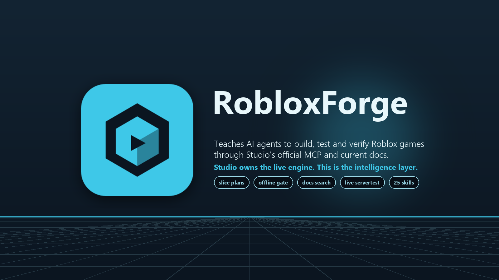
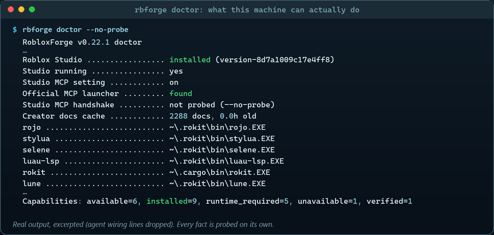
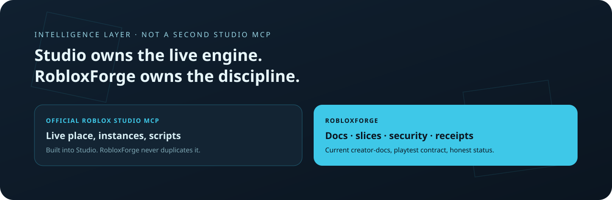

<div align="center">



[](https://github.com/SenjuWoo/RobloxForge/actions/workflows/ci.yml)
[](https://github.com/SenjuWoo/RobloxForge/releases/latest)
[](.github/workflows/ci.yml)
[](LICENSE)

**[Install](#install)** · **[Tour](#a-two-minute-tour)** · **[Commands](#commands)** · **[Skills](#the-skill-catalog-the-actual-product)** · **[How it works](#how-it-works)** · **[Status](#status)** · **[Changelog](CHANGELOG.md)**

</div>

RobloxForge is a free, local-first workbench that teaches general AI agents how to
build, test, debug and verify Roblox games using Roblox Studio's official MCP and
current Roblox documentation. A good model plus the official Studio MCP already has
Studio control, and it still builds bad games: wrong architecture, no playtesting,
stale API knowledge, "done" declared on untested code. RobloxForge is the missing
intelligence layer: current docs, vertical-slice discipline, ownership and security
rules, and verification receipts. **It is not another Studio MCP.** The official one,
built into Roblox Studio, owns the live engine, and RobloxForge never duplicates it.

## What you get

- **One slice at a time.** `rbforge new` writes a working starter kit (loader, remotes, rate limiter, safe load/save, HUD, specs) plus a slice plan that says who owns what and what to prove before expanding.
- **A gate before Studio boots.** `rbforge check` runs StyLua, selene, luau-lsp with Roblox definitions, Lune unit specs and a structure audit. Anything it could not run is reported as `incomplete`, never `pass`. Vendored packages, recovery snapshots, git-ignored folders and nested worktrees are left out and counted.
- **Current docs, not model memory.** `rbforge docs` keeps a local sparse copy of Roblox's public creator-docs and ranks results by what a page declares.
- **Live tests that prove something.** `rbforge servertest` runs a test as a temporary server Script in Play through the official MCP, with `--repeat N --restart` streaks, the failed run's console kept, and a per-project run ledger.
- **Pushes that never eat someone's edit.** `rbforge push` checksums every write, refuses during Play, refuses to overwrite a script edited in Studio since the last push, and backs up whatever it replaces.
- **Receipts with levels.** Only a scenario whose observations RobloxForge recorded reaches `verified_playtest`; a claim stays a claim.
- **25 agent skills** for Hermes, Claude Code, Codex, Grok and Kimi, and a 19-tool MCP server that is wired in **disabled** so it costs no context outside Roblox work.



## Install

**Windows:** download the source zip from the [latest release](https://github.com/SenjuWoo/RobloxForge/releases/latest), extract it, and run `START-HERE.bat` (guided first run: installs the skills, runs doctor). Or from a shell:

```powershell
git clone https://github.com/SenjuWoo/RobloxForge
cd RobloxForge
.\Install.ps1                    # install the skills into your agents, then doctor
```

The scriptable lifecycle does the same work with no prompts and real exit codes:

```powershell
.\Install.ps1 -ConnectMcp -Docs  # also wire the official Studio MCP and fetch docs
.\Install.ps1 -Toolchain         # also install the pinned Luau toolchain (rokit, rojo, stylua, selene, ...)
.\Install.ps1 -Agent claude      # one agent instead of all
.\Update.ps1                     # git pull, then refresh the agent-side copies
.\Uninstall.ps1                  # remove the wiring RobloxForge put in your agents
.\Uninstall.ps1 -WhatIfOnly      # show what would be removed, change nothing
.\Uninstall.ps1 -RemoveState     # also delete the machine state listed below
```

Needs Python 3.11+. The code runs from this checkout; nothing is installed elsewhere.
`rbforge` is `rbforge.cmd` in the checkout: run it from there, add the folder to
`PATH`, or call `python src\rbforge_cli.py` directly.

What it writes lives in one state folder outside the checkout, `%LOCALAPPDATA%\RobloxForge`
(override with `RBFORGE_HOME`): the creator-docs cache, verification receipts, the push
ledger, the run ledger, cached type definitions and backups of agent configs it edited.
`Uninstall.ps1` un-wires the agents first, while the CLI that knows what it wrote still
exists; delete the folder without it and each agent keeps a skill for a tool that is gone
and an MCP entry pointing at a path that no longer resolves. It keeps the state folder
unless you pass `-RemoveState`, and leaves the checkout for you to remove.

Nothing here costs money. Roblox Studio, the official MCP server, every recommended
library and every asset path in the skills are free; `rbforge plugins` reports what each
paid tool would change and what replaces it for $0.

## A two-minute tour

```text
rbforge doctor                      # full health report, each fact independent
rbforge new mygame --genre obby --premise "dodge lasers and reach the end"
rbforge check mygame                # offline gate: format, lint, types, unit specs, structure
rbforge docs update                 # fetch official creator-docs (git-sparse)
rbforge docs search "ProcessReceipt"
rbforge push src/Server/Main.server.luau   # or ALL; checksum readback, conflict guard
rbforge servertest tests/Combat.server.luau CombatTest --ready "workspace.BootStage=players-wired"
rbforge servertest tests/Boss.client.luau --dm Client --repeat 3 --restart   # 3 passes in a row, fresh Play each
rbforge servertest --suite tests/suites.json --sessions 2 --detach  # release proof in the background
rbforge runs --job <id> --wait      # done / running (exit 5) / died, with the run's report
rbforge runs --text                 # every recorded live run: pass rate, streaks, last failure
rbforge audit .                     # existing project: what to fix first, ranked
```


`servertest` needs a running playtest (it refuses Edit mode with exit 4) unless `--restart`
owns Play. The test reports by setting the attribute to `"PASS ..."` or `"FAIL ..."` on
`workspace` or on its own Script. Cleanup destroys the test Script, which kills the threads
it started; use `--grace <seconds>` when the test triggers deferred game work. `--repeat N`
exits 0 only for N passes in a row; the first failure stops the streak and leaves that Play
session running for inspection. A failed run keeps the console it printed (error lines in
the report, the whole text in `console_log`), and every run lands in a per-project ledger
that `rbforge runs` reads. Details:
`skills/roblox-game-development/references/testing-debugging.md`.

## Commands

`doctor` and `check` print a readable report (`check --json` for machines); the other
commands print JSON.

| Need | Command |
|---|---|
| Health report, each fact probed on its own | `rbforge doctor [--no-probe]` |
| Honest capability matrix (probed, not assumed) | `rbforge capabilities` |
| New project: starter kit + slice plan + next steps | `rbforge new <path> --genre <g> --premise "..."` · `scaffold` |
| Slice plan only | `rbforge plan <genre> "<premise>"` |
| Offline gate before Studio | `rbforge check [path] [--scope static unit structure] [--changed-only] [--json]` |
| Existing project: ranked fix order, every remote handler | `rbforge audit [path]` · `review` · `project` |
| Which optimization levels this project has earned | `rbforge optimize [--root] [--premise]` |
| Creator-docs cache | `rbforge docs status\|update\|search\|read` |
| Roblox type definitions for luau-lsp | `rbforge types status\|fetch` |
| Luau toolchain status | `rbforge tools` |
| Push sources into Studio, checksum-verified | `rbforge push <files\|ALL> [--force]` |
| Run Luau in Studio / ready-made diagnostics | `rbforge exec <file>` · `rbforge probe [name] [--run]` |
| Live test in Play | `rbforge servertest <file> <attr> [--suite] [--repeat N --restart] [--dm Client]` |
| Live run history | `rbforge runs [--test] [--last N] [--text]` |
| Optional plugins and their free alternatives | `rbforge plugins` |
| Optional 3D route (Blender, GLB budget; never uploads) | `rbforge assets status\|check <export>` |
| Optional external map prover | `rbforge map status\|prove <spec>` |
| Agent wiring and skills | `rbforge agent status\|connect\|disconnect <agent\|all>` · `rbforge skills status\|install\|update\|remove` |

### Verification levels

A receipt says how much was actually observed, and only one level means "it works":

| Level | Means |
|---|---|
| `unverified` | nothing usable |
| `static_only` | static checks passed, no runtime evidence |
| `playtest_claimed` | the agent says it tested; RobloxForge observed nothing |
| `playtest_observed_partial` | tooling observed a run, but a test, console read or inspected screenshot is missing |
| `playtested_with_errors` | an observed run reported errors |
| `verified_playtest` | a scenario ran and its observations were recorded by RobloxForge |

`verified_playtest` needs an `observation_id` from `rb_collect_evidence`; a receipt that merely
claims `provenance="tool"` is downgraded to the caller's word.

### Pushing scripts safely

`rbforge push src/Server/Main.server.luau` (or `ALL`) copies sources into the open place through the
official Studio MCP and reads each one back. It remembers what it wrote, so a script someone edited in
Studio since the last push is refused as a `conflict` instead of being overwritten; `--force` overwrites
it. Whenever push replaces a source it did not write itself, the Studio copy is cloned into
`ServerStorage.rbforge_backups` first and listed under `backed_up`. A push during Play is refused
(`RBF-PLAY-002`).

## Connecting agents (installed OFF by default for token discipline)

The 19 `rb_*` MCP tools are useful during Roblox work but waste context in every other
session. `rbforge agent connect` therefore wires the forge's MCP server **disabled** into
each agent, and `rbforge skills install` installs the skill catalog: 25 skills, always on
but free until a Roblox prompt triggers them.

```text
rbforge agent connect all       # or: hermes | claude | codex | grok
rbforge skills install all
rbforge agent status
```

| Agent | Wired as | Enable for a Roblox session |
|---|---|---|
| Hermes | `robloxforge`, `enabled: false` | `hermes config set mcp_servers.robloxforge.enabled true`, restart |
| Claude Code | user-scope + per-project disable array | `/mcp` toggle in-session (no global off-switch exists; brand-new dirs start enabled) |
| Codex | `[mcp_servers.robloxforge] enabled = false` | flip the flag in `~/.codex/config.toml` |
| Grok | same TOML shape | `grok mcp enable robloxforge` |
| Kimi | skills only | add the official Studio MCP yourself; `rbforge doctor` prints the command |

Disable again when done to reclaim the tool schemas. The official Roblox Studio MCP
(`roblox-studio` / `mcp.bat`) is separate and stays enabled; it is only useful when Studio
is open anyway.

## The skill catalog (the actual product)

- **roblox-game-development**: router skill: vertical slices per genre, server/client ownership, security rules, playtest contract, sharp edges.
- **roblox-docs**: current-knowledge system: search and read the official `Roblox/creator-docs` corpus locally, freshness reported honestly.
- **23 topic skills** (`roblox-luau`, `roblox-networking`, `roblox-data-stores`, ...) adopt the MIT EL4CTEO pack verbatim; `references/assistant-skills.md` routes to them.

`rbforge skills status` reports every skill per root (`current`, `partial`, `modified`, `stale`,
`foreign`) and only calls an agent `current` when every one of its profiles agrees.
Resolution priority baked into both first-party skills: observed runtime > current official
docs > verified community practice > model memory.

## How it works

<p align="center">
  
</p>

| Piece | What |
|---|---|
| `src/rbforge_cli.py` | the CLI |
| `src/rbforge/check.py` | offline verification gate (rungs 1-3 of the ladder) |
| `src/rbforge/audit.py` | health audit of an existing project: a ranked fix order and every remote handler with its guards |
| `src/rbforge/plugins.py` | optional-plugin detection, each with a free alternative |
| `src/rbforge/assets.py` | optional 3D route: Blender and Roblox add-on detection, GLB triangle budget check (never uploads) |
| `src/rbforge/mapkit.py` | optional adapter for an external map prover: discovers it, checks its deps, returns its own report (never touches Studio) |
| `templates/starter/` | the working starter kit `rbforge new` writes: loader, remotes, rate limiter, safe load/save, HUD, specs |
| `mcp_server/server.py` | 19-tool MCP server (doctor, capabilities, docs, check, audit, plugins, assets, planning, reviews, receipts, probes, traps, evidence) |
| `skills/` | 25 agent skills (2 first-party + 23 adopted MIT topic skills), installed into Hermes/Claude/Codex/Grok/Kimi |
| `tests/run_tests.py` | 269 checks, no Roblox required |

- **Runs from the checkout.** No daemon; machine state lives in one folder you can delete.
- **Absence is a skip, never a pass.** A missing formatter lowers coverage and the report says so.
- **Studio work goes through the official MCP.** RobloxForge reads state, pushes sources and runs tests through it; it never ships its own engine bridge.
- **Third-party tools are evaluated, not vendored.** See [docs/INTEGRATIONS.md](docs/INTEGRATIONS.md).

Register the MCP server manually (all agents, disabled) instead of using the installer:

```text
python src\rbforge_cli.py agent connect all
```

## Status

0.23.0. Only what was observed is listed as verified.

| Area | Status |
|---|---|
| Studio + official MCP detection & live handshake probe | verified on Windows 11 (41 tools, 2026-11-24) |
| `rbforge servertest`: Play preflight, `--ready`, Client tests, `--grace`/`--keep`, `--suite` | verified against a live Studio place (0.18.0) |
| `servertest --repeat/--restart`, failure console capture, run ledger (`rbforge runs`) | verified offline against a session double (0.22.0). Live 2026-11-26 on a disposable place: `--sessions 2` (= `--repeat 2 --restart`) started Play from Edit, restarted it and passed both runs. Failure console capture **not yet run live** |
| `servertest --detach`, `runs --job --wait`, Studio lock, source snapshots (0.23.0) | verified live on a disposable place: detached `--suite --sessions 2` PASS 2/2 in 17 s with `source_sha256` and the tested commit in the report; a second `rbforge exec` during the run refused (`RBF-STUDIO-004`); a manifest entry that could not be read failed as its own suite |
| `save-check` probe, `exec` no-return note, `assets check --require-uv` (0.23.0) | `save-check` live: two test attributes -> "no", cleared -> "yes"; `exec` live: Studio returns `nil` for no return and `print()` is not returned; UV check on fixtures |
| creator-docs sparse cache + ranked search | verified (2,288 docs indexed, 2026-11-25) |
| `rbforge check` offline gate (static / unit / structure) | verified; skips reported as `incomplete`, never `pass`. Vendored, snapshot, git-ignored and nested-worktree paths left out of every rung (0.22.1, reproduced on a fixture with a vendored package and a git worktree) |
| `rbforge new` one-command project + plan | verified; the starter kit passes its own gate, and its live server test, client remote path and HUD were run and inspected in Studio Play (0.19.0). The 0.22.0 refusal reasons (`LastRefusal`) pass the static gate; the extended live test has not been run in Studio yet |
| `rbforge audit` ranked project health report | verified offline on fixtures and on a 35k-line production project (0.19.0) |
| `rbforge push`: checksum readback, rollback, class-change backup | verified against a live Studio place |
| `rbforge push` refuses during Play (`RBF-PLAY-002`) | verified against a live Studio place (0.20.0): refused in Play with exit 4, 10/10 synced after Stop |
| `world-audit` probe (floating, inside, stray attachments) | verified against a live Studio place (0.20.0): three planted faults found, three controls quiet, skip list reported |
| Trap lint T046 (deprecated `InputAction:Fire`, `AnalyticsService:Fire*`) | verified offline on fixtures and on a production project: 12 hits, all real deprecated calls, no false positives (0.21.0) |
| `rbforge push` conflict guard and backup-before-overwrite | verified against a live Studio place (0.17.2): conflict, `--force` backup, ledger re-push |
| Plugin detection with a free alternative for every entry | verified (filename-based) |
| Doctor, capabilities matrix | verified |
| Skill install into every Hermes profile, Claude/Codex/Grok/Kimi | verified; manifest-backed, per-profile status, non-destructive reinstall |
| Verification receipts: observed console, inspected screenshot, server test | verified live (`verified_playtest` reached and refused correctly) |
| Real E2E weak-model benchmark (baseline vs RobloxForge obby) | **not yet run** |

v1.0.0 waits for the E2E benchmark proving behavioral improvement. See
[tests/agent-benchmarks/01-weak-model-obby.md](tests/agent-benchmarks/01-weak-model-obby.md).
Every release is listed in the [changelog](CHANGELOG.md).

## Trademark notice

Not affiliated with, endorsed by, or sponsored by Roblox Corporation.
"Roblox" and "Roblox Studio" are trademarks of Roblox Corporation, used
here descriptively. Roblox documentation is fetched at runtime from
Roblox's public repository (CC-BY-4.0) and never redistributed by this repo.

## License

[MIT](LICENSE)
