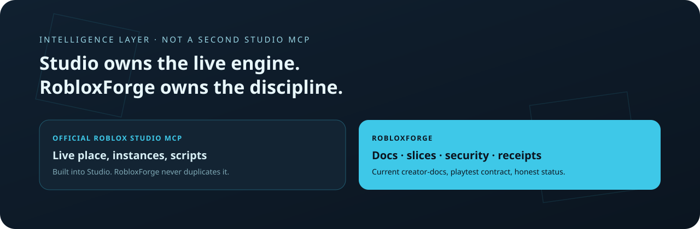

<p align="center">
  
</p>

<div align="center">

# RobloxForge

**Studio owns the live engine. This is the intelligence layer.**

A free, local-first workbench that teaches general AI agents how to build,
test, debug and verify Roblox games using Roblox Studio's official MCP and
current Roblox documentation.

<p>
  <a href="https://github.com/SenjuWoo/RobloxForge/actions/workflows/ci.yml"></a>
  <a href="LICENSE"></a>
  <a href="https://github.com/SenjuWoo/RobloxForge/releases/latest"></a>
  
</p>

<p>
  <a href="#quickstart">Quickstart</a>
  ·
  <a href="#the-two-skills-the-actual-product">Skills</a>
  ·
  <a href="#status-v030--honest">Status</a>
  ·
  <a href="tests/agent-benchmarks/01-weak-model-obby.md">Benchmark</a>
</p>

</div>

<p align="center">
  
</p>

RobloxForge is a free, local-first AI development workbench that teaches
general AI agents how to build, test, debug and verify Roblox games using
Roblox Studio's official MCP and current Roblox documentation.

**The problem it solves:** a good general model + the official Roblox Studio
MCP technically gives an agent Studio control, but it still builds bad games —
wrong architecture, no playtesting, stale API knowledge, "done" declared on
untested code. RobloxForge is the missing intelligence layer: current docs,
vertical-slice discipline, ownership rules, security rules, verification
receipts.

**What it is NOT:** another Studio MCP. The official one (built into Roblox
Studio) owns the live engine. RobloxForge never duplicates it.

### Verification levels

A receipt says how much was actually observed, and only one level means "it works":

| Level | Means |
|---|---|
| `unverified` | nothing usable |
| `static_only` | static checks passed, no runtime evidence |
| `playtest_claimed` | the agent says it tested; RobloxForge observed nothing |
| `playtest_observed_partial` | tooling observed a run, but a test, console read or inspected screenshot is missing |
| `playtested_with_errors` | an observed run reported errors |
| `verified_playtest` | a scenario ran and its observations were recorded by RobloxForge |

`verified_playtest` needs an `observation_id` from `rb_collect_evidence`; a receipt that merely
claims `provenance="tool"` is downgraded to the caller's word.

## Quickstart

```
START-HERE.bat          # guided first run (installs skills, runs doctor)
```

Or the scriptable lifecycle -- same work, no prompts, real exit codes:

```
.\Install.ps1                    # install the skills into your agents, then doctor
.\Install.ps1 -ConnectMcp -Docs  # also wire the official Studio MCP and fetch docs
.\Update.ps1                     # git pull, then refresh the agent-side copies
.\Uninstall.ps1                  # remove the wiring RobloxForge put in your agents
.\Uninstall.ps1 -WhatIfOnly      # show what would be removed, change nothing
```

RobloxForge runs from this checkout -- nothing is copied to `%LOCALAPPDATA%`.
So `Uninstall.ps1` does the part that deleting the folder cannot: it un-wires
the agents first, while the CLI that knows what it wrote still exists. Delete
the folder without it and each agent keeps a skill for a tool that is gone and
an MCP entry pointing at a path that no longer resolves. The checkout itself is
left for you to remove.

```
rbforge new mygame --genre obby --premise "dodge lasers and reach the end"
rbforge doctor                      # full health report, each fact independent
rbforge check .                     # offline gate: format, lint, types, structure
rbforge plugins                     # optional plugins found + their free alternatives
rbforge docs update                 # fetch official creator-docs (27 MB, git-sparse)
rbforge docs search "ProcessReceipt"
rbforge agent connect hermes        # wire the official Roblox MCP into an agent
rbforge skills install all          # install the two RobloxForge skills
rbforge capabilities                # honest capability matrix (probed, not assumed)
```

Nothing here costs money. Roblox Studio, the official MCP server, every
recommended library and every asset path in the skill are free; `rbforge
plugins` reports what each paid tool would change and what replaces it for $0.

## Connecting agents (installed OFF by default — token discipline)

The 17 `rb_*` MCP tools are useful during Roblox work but waste context in
every other session. `rbforge agent connect` therefore wires the forge's
MCP server **disabled** into each agent, and installs the skill catalog - 25
skills (2 first-party, 23 adopted MIT topic skills), always-on but free until a
Roblox prompt triggers them:

```
rbforge agent connect all       # or: hermes | claude | codex | grok
rbforge skills install all
rbforge agent status
```

Per-agent enable/disable:

| Agent | Wired as | Enable for a Roblox session |
|---|---|---|
| Hermes | `robloxforge`, `enabled: false` | `hermes config set mcp_servers.robloxforge.enabled true`, restart |
| Claude Code | user-scope + per-project disable array | `/mcp` toggle in-session (no global off-switch exists; brand-new dirs start enabled) |
| Codex | `[mcp_servers.robloxforge] enabled = false` | flip the flag in `~/.codex/config.toml` |
| Grok | same TOML shape | `grok mcp enable robloxforge` |

Disable again when done to reclaim the tool schemas. The official Roblox
Studio MCP (`roblox-studio` / `mcp.bat`) is separate and stays enabled — it
is only useful when Studio is open anyway.

## The skill catalog (the actual product)

- **roblox-game-development** — router skill: vertical slices per genre,
  server/client ownership, security rules, playtest contract, sharp edges.
- **roblox-docs** — current-knowledge system: search + read the official
  `Roblox/creator-docs` corpus locally, freshness reported honestly.
- **23 topic skills** (`roblox-luau`, `roblox-networking`, `roblox-data-stores`, ...) adopt the MIT
  EL4CTEO pack verbatim; `references/assistant-skills.md` routes to them.

`rbforge skills status` reports every skill per root (`current`, `partial`, `modified`, `stale`,
`foreign`) and only calls an agent `current` when every one of its profiles agrees.

Resolution priority baked into both: observed runtime > current official
docs > verified community practice > model memory.

## Components

| Piece | What |
|---|---|
| `src/rbforge_cli.py` | CLI — every command prints JSON |
| `src/rbforge/check.py` | offline verification gate (rungs 1-3 of the ladder) |
| `src/rbforge/plugins.py` | optional-plugin detection, each with a free alternative |
| `mcp_server/server.py` | 13-tool MCP server (doctor, capabilities, docs, check, plugins, planning, reviews, receipts) |
| `skills/` | the two agent skills, installed into Hermes/Claude/Codex/Grok/Kimi |
| `tests/run_tests.py` | 33 checks, no Roblox required |

Register the MCP server manually (all agents, disabled) instead:

```
python src\rbforge_cli.py agent connect all
```

## Status (v0.3.0 — honest)

| Area | Status |
|---|---|
| Studio + official MCP detection & live handshake probe | verified on Windows 11 (34 tools) |
| creator-docs sparse cache + ranked search | verified (2,214 docs indexed) |
| `rbforge check` offline gate (static / unit / structure) | verified; skips reported as `incomplete`, never `pass` |
| `rbforge new` one-command project + plan | verified |
| Plugin detection with a free alternative for every entry | verified (filename-based; none installed here) |
| Doctor, capabilities matrix | verified |
| Skill install into Hermes (live), Claude/Codex/Grok/Kimi roots | verified, multi-profile |
| Vertical-slice planning, reviews, hash-chained verification receipts | implemented, static-only |
| Real E2E weak-model benchmark (baseline vs RobloxForge obby) | **not yet run** |

v1.0.0 waits for the E2E benchmark proving behavioral improvement. See
`tests/agent-benchmarks/01-weak-model-obby.md`.

## Trademark notice

Not affiliated with, endorsed by, or sponsored by Roblox Corporation.
"Roblox" and "Roblox Studio" are trademarks of Roblox Corporation, used
here descriptively. Roblox documentation is fetched at runtime from
Roblox's public repository (CC-BY-4.0) and never redistributed by this repo.

## License

[MIT](LICENSE)
